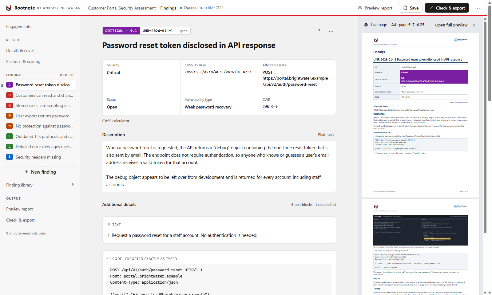

# Rootnote

Rootnote is a free, open-source pentest report writer. Organise findings and screenshots, then export an editable Word report (also Markdown, CSV and print/PDF). It is one HTML file that runs in your browser, online or downloaded, and your report content is processed on your computer: there is no report upload and no report database.

- Use it online, or download it: https://rootnote.unravelnetworks.com (also attached to each [GitHub release](https://github.com/unravelnetworks/rootnote/releases))
- Step-by-step guide: https://rootnote.unravelnetworks.com/guide/
- Short demo video (an edited walkthrough of the fictional sample): https://youtu.be/AHG4aabI8Lw
- How it compares with other pentest reporting tools: https://rootnote.unravelnetworks.com/alternatives/
- Licence: [Apache-2.0](LICENSE). Third-party components keep their own licences; see [THIRD-PARTY-NOTICES](release-template/THIRD-PARTY-NOTICES.md).

Developed with AI-assisted tooling; reviewed and maintained by Unravel Networks.

Open source means you can read, build and check the code. Rootnote has not had an independent security audit.

## What it does

- Findings with severity or CVSS Base scores (CVSS 3.1 or 4.0, one version per report), CWE, affected assets, references and your own sections.
- Paste screenshots into a finding; black out, crop and annotate them in the app.
- Word output with real styles, numbered figure captions and a findings summary that links to each finding.
- A built-in sample report (fictional client, synthetic evidence) and starter findings.

Tested up to 150 findings, 400 screenshots and a 256 MB project file, on Windows in Chrome, Edge and Firefox, on a machine with 64 GB of RAM. Reports that large need a lot of memory, and Firefox needs the most. On a machine with less RAM, work in Chrome or Edge and keep large reports smaller. These are sizes we have tested, not a paid tier. Everything in Rootnote is free. Tell us if the limits prevent your normal work.

What has been tested: Windows desktop Chrome, Edge and Firefox. Basic Safari/macOS use and iPhone 11 Pro Safari exploration have been checked by hand. Safari PDF verification and native document-consumer checks (Word for Mac, LibreOffice) are still incomplete. Phone report writing and saving is not qualified.

## Build and test

Requires Node.js 20 or newer (CI uses 22).

    npm ci
    npm run build      # dist/rootnote.html: one bundled file; no external resources needed for report editing
    npm test           # full suite; browser tests need Chrome, Edge and Firefox installed
    npm run release    # release/rootnote-<version>.zip with README, guide, notices and SHA256SUMS
    npm run site -- release/rootnote-<version>.zip   # site/out/: the static website
    npm run site:serve # serve site/out/ with its security headers on http://127.0.0.1:8644

Every published release lists the SHA-256 of the app and of the download zip on the website and in [.github/published-sha256.txt](.github/published-sha256.txt). To check that the live site serves exactly those files: `bash .github/check-live.sh https://rootnote.unravelnetworks.com .github/published-sha256.txt`. A daily workflow runs the same check. Hashes show that you have the bytes we published; to check that those bytes correspond to this source, build the tagged release with the locked dependencies and compare `dist/rootnote.html` with the published app hash. Neither is an independent security audit.

## Layout

| Path | What |
|---|---|
| `src/app/` | Project model, validation, limits, CSV, recovery draft |
| `src/editor/` | The editor UI and the paged preview |
| `src/export-docx/` | The Word export |
| `schema/` | JSON schemas of the project file (frozen per version) |
| `docs/guide/` | Guide sources (online pages and the offline `guide.html`) |
| `release-template/` | Files shipped in the download: README, sample, starters, notices |
| `tests/` | Unit and browser tests (`tests/harness/` drives Chrome, Edge and Firefox) |
| `site/` | The website for rootnote.unravelnetworks.com: build, security headers, local server, guide screenshots |

How the pieces fit together, the file-format rules and the release steps: [docs/architecture.md](docs/architecture.md).

## Contributing, feedback and security

Bug reports, ideas and platform checks are welcome; see [CONTRIBUTING.md](CONTRIBUTING.md). Use synthetic data only: never post or attach client or employer material. Report security problems privately: [SECURITY.md](SECURITY.md).

## Licence scope, names and logos

Except for identified third-party material, project-authored code, documentation, finding-library text and sample assets are provided under Apache-2.0. Third-party material retains its own licences.

No trademark rights in Rootnote or Unravel Networks are granted beyond the licence's allowance for describing origin and reproducing notices. Retaining the supplied branding in unmodified copies and sample reports is permitted; do not imply endorsement of a modified version. Use distinct branding for a separately marketed fork.

Copyright 2026 Unravel Networks.
